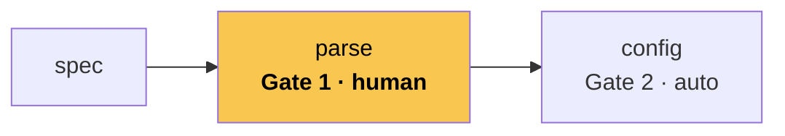

# Q3TUI

**Q3 = Quality · Quick · Quorum.** A terminal UI and CLI that takes a hardware IP block from intent to
verified, synthesizable RTL through a gated, agentic pipeline — built on the
[Claude Agent SDK](https://code.claude.com/docs/en/agent-sdk), with EDA tools (lint, synthesis, simulation)
behind pluggable, vendor-agnostic role adapters.

Product of **VLSI Technology**.

## Overview

Q3TUI runs the **spec flow** (`spec → parse (requirements) → config (parameters)`), and the **rtl flow** on top of it
(rules, CSR, RTL, format, style lint, smoke test). Every phase that needs a human decision
stops at a **gate**; everything else — naming-rule compliance, lint, formatting, the smoke simulation —
is checked deterministically by code, not trusted to the model's word. The testbench, SVA, verification (simulation, mutation, sign-off) and document
steps of the former VLSIT flow were removed and are to come back as their own flows. You can drive the
whole thing from the **TUI** (`q3tui`), the **CLI** (`q3tui run`, `q3tui status`, …), or by chatting with the
built-in assistant, which has a tool for every action a key or command has.

See the **[User guide](docs/user_guide/)** for how to install, run, and work the flow day to day (English and
Vietnamese), and `docs/spec/` for the underlying design and architecture reference.

## The flow



Yellow = a gate that stops for your review by default. The `rtl` flow continues from `config` (below).

## Other flows

`pipeline.flow` picks the flow (`q3tui flow list`). Besides `spec`:

- **`rtl`** — RTL on its own, checked and ready for verification: `spec → parse → config → rules → csr → rtl → format → style_lint → smoke`. Your rules
  (`config/rtl_rules.md`) over Q3TUI's defaults become **Verible** flags (checked for contradictions before any RTL is written); the software-visible
  registers are **generated** by the [APB-CSR-Generator](https://github.com/nguyenquanicd/APB-CSR-Generator) from a register map drafted from the spec
  (`q3tui act csr_tool_install`); the RTL is formatted, style-linted by an LLM judge whose fixes go back to `rtl`, and smoke-tested with a testbench
  written from the spec alone. The chain and its fix loops run by themselves. LLM stages use markdown **skills** (`config/skills/<name>/SKILL.md`, yours
  can replace or add). See [docs/spec/rtl-flow.md](docs/spec/rtl-flow.md).
- `fpga`, `asic`, `project` — synthesis / PPA estimation and the project settings ([docs/spec/flows.md](docs/spec/flows.md)).

## The TUI


**Pipeline** (left): every step with its status icon, number and gate mode or what it is waiting for. **Step
view** (top right): the selected step's result in tabs — here the requirements `parse` extracted, two flagged
for your review, the highlighted one in detail. **Activity** (bottom right): the live log of the run.
**Command / chat bar**: a `/command`, or plain text to the assistant. The footer lists the keys of what has
focus.

<table>
<tr>
<td width="50%"><a href="docs/images/tui-gate.svg"></a></td>
</tr>
<tr>
<td><b>Review dialog</b> (<code>a</code>): approve, answer the open questions, edit, or request changes.</td>
</tr>
</table>

## Features

- **Gated pipeline, not a black box.** One human review gate by default (the requirements `parse` extracts);
  the configuration signs itself when its checks pass. Every gate's mode
  (`human` / `auto` / `auto_answer` / `none`) is switchable per project or per session.
- **Updates, not re-runs.** Changing one requirement updates only the modules and tests it touches — the rest
  of the design, and your review approvals, stay as they were.
- **RTL rule enforcement, deterministically.** Naming conventions, prohibited constructs (delays, latches,
  signed types, testbench-only system tasks, …), file/module-name consistency and more are checked by a
  code-level linter against your project's rule file(s) — the LLM gets the same rules as text, but never has
  the final word on compliance.
- **Traceable requirements.** Every requirement has an ID (`REQ-NNN`); the RTL cites the ones it implements,
  and the rtl flow's smoke test is written from the spec and the requirements alone, never from the RTL.
- **Review what needs reviewing, nothing more.** Flagged requirements and changed parameters each
  have their own pending-review tracking, separate from blocking questions — gates refuse to self-approve
  until you've actually looked, unless you turn that off deliberately (`auto_confirm_reviews`).
- **Chat like the rest of the team.** The in-TUI assistant can run steps, answer questions, change gate
  modes, adjust settings, review requirements and parameters — anything a key or `/command` can do —
  and replies in whichever language you write to it in.
- **Language-aware chrome.** The TUI's own interface (status legend, result banners, dialogs) and the
  pipeline's generated content (spec, RTL comments, questions, docs) follow one `tui.language` setting
  (English / Vietnamese / Korean); the assistant conversation is the one exception, mirroring your own
  language instead.

See **[FEATURES.md](docs/FEATURES.md)** for the full feature inventory (pipeline engine, every step, gates and
review in depth, RTL rule enforcement, the TUI, the CLI, the assistant, settings, and known beta
limitations).

## Version history

| Version | Date | Status | Author(s) | Notes |
|---|---|---|---|---|
| 0.1.0 | 2026-10 | **Beta** | Ethanoctis, superdalink | spec flow (spec → parse → config) and rtl flow; TUI, CLI and assistant parity. |

## Quick start

```bash
uv sync                                   # Python >= 3.11
mkdir -p ~/.q3tui && cp q3tui.example.yaml ~/.q3tui/q3tui.yaml   # EDA modules, default model

mkdir my_block && cd my_block
mkdir spec && echo "# My Block" > spec/my_block_spec.md   # or q3tui init for a template skeleton
q3tui                                     # opens the TUI — press r to run, a to review, o for questions
```

Full install options, the step-by-step flow, every setting and command: see the
**[User guide](docs/user_guide/)**.
