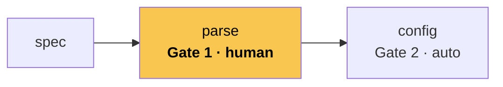

# Q3TUI Feature Inventory

This inventory reflects the current source as of **2026-10** (version 0.1.0, Beta) and focuses on the
**spec flow** (`spec → parse → config`), the flow this product ships with
by default, and the **rtl flow** that builds on it. The testbench, SVA, verification and document steps of the former VLSIT flow were removed. See the [User guide](user_guide/) for how to use everything listed here, and [spec/](spec/) for
the architecture reference.

## 1. Pipeline engine

- **Content-hash staleness.** Every step snapshots what it was built from; a later run re-checks the hash
  and skips the LLM entirely when nothing relevant changed.
- **Update, not re-run.** A changed requirement, parameter or a change request you queue updates only the
  steps it actually touches — unaffected steps and your existing gate approvals stay as they were.
- **Run any range.** `q3tui run [from] [to]`, or `only=<step>` — resume after a crash, re-run one step, or
  drive the whole pipeline in one call.
- **One run at a time, watchable from elsewhere.** A lock file means a second process (e.g. the TUI while
  the CLI is mid-run) only watches, never double-runs.
- **Reset with a plan.** `q3tui reset <step>` shows exactly which generated files would be deleted (and
  backs them up) before you confirm; your own hand-written files are never touched.

## 2. The spec flow

| Step | What it does | Gate |
|---|---|---|
| spec | Drafts (or accepts your) IP specification, section by section, from an intent or as-is. | human |
| parse | Extracts requirements (REQ-IDs), parameters and the module map; flags ambiguity. | **1 · human** |
| config | Resolves parameter values against your change requests; checks elaboration constraints. | 2 · auto |

### The RTL flow (`rtl`, docs/spec/rtl-flow.md)

- **Rules → Verible:** `config/rtl_rules.md` (yours, wins) over `rtl_rule_default.md`; the `rules` step checks the stack for contradictions before any RTL is
  written and writes the Verible lint / format flags (verified with the real tool; a flag Verible refuses is never read as "clean").
- **Generate → format → style lint → fix**: `format` changes whitespace only (checked, backed up, asks before touching a hand-edited file); `style_lint` runs Verible,
  an LLM judge decides per finding (violation / flag problem / acceptable) and violations go back to `rtl` as scoped change requests; the engine's fix loop repeats it.
- **CSR from a generator**: the registers come from the APB-CSR-Generator, driven from a register map (`src/rtl/csr/csr_map.json`) drafted from the spec; the map is checked
  by code (the tool checks nothing); the generated module is *provided* to `rtl` (instantiated, never rewritten by an LLM).
- **Smoke test** written from the spec alone (the writer cannot read the RTL), compiled and run by code; failures are triaged (RTL / testbench / spec) and fixed or asked.
- **Skills and tools for the LLM**: markdown playbooks it reads when needed plus in-process tools (`verible_*`, `smoke_*`, `csr_check`); Q3TUI confines files and checks results.

## 3. Gates and review

- **Four gate modes** per step: `human` (always stops), `auto` (self-signs once no blocking question is
  open), `auto_answer` (unattended — also answers every question with its default), `none`.
- **Two independent things a gate can wait on:** a *blocking question* (an actual decision only a human can
  make) and *unconfirmed review items* (flagged requirements, changed parameters). A `human`
  gate's plain `Approve` refuses while either is open; an `auto`/`auto_answer` gate only cares about blocking
  questions.
- **Per-item review, not a rubber stamp.** `c`/`u`/`C` (confirm / back to pending / confirm all) for
  flagged requirements and changed parameters.
- **Dedicated opt-out.** `pipeline.auto_confirm_reviews` turns off the per-item review requirement
  specifically, independent of the broader auto-approve/auto-answer switches — gates still stop for the
  things that actually matter.

## 4. Removed: traceability, verification, document

The testbench, SVA, verification (simulation, mutation testing, the six-condition requirements traceability matrix with your sign-off) and the specification document (Markdown + PDF) were steps of the former VLSIT flow. They are removed; nothing in this inventory describes them any more.

## 5. RTL coding rule enforcement

- **Rule files as the single source of truth**, read by the RTL stage's own prompt *and* checked
  deterministically by code — naming prefixes (ports, registers, instances, modules, parameters), file/
  module-name consistency, name length, and a list of prohibited constructs (delays, latches, `casex`,
  `defparam`, signed types/literals, two-state types, testbench-only system tasks such as `$display`/
  `$finish`/`$random` — with `$error` allowed only as the sanctioned elaboration-time parameter-validation
  exception — and more).
- **Project-overridable.** A default baseline ships with the flow; a project can add its own rule file
  (`pipeline.step_options.rtl.rules`) on top, or override the default outright with a same-named file.
- **The LLM never has the final word.** Every RTL-writing stage can call a `check` tool mid-turn and
  self-correct before finishing; what actually ships still goes through the same deterministic check.

## 6. Terminal UI (TUI)

**Pipeline** (left): every step with its status icon, number and gate mode or what it is waiting for. **Step
view** (top right): the selected step's result in tabs — here the requirements `parse` extracted, two flagged
for your review, the highlighted one in detail. **Activity** (bottom right): the live log of the run.
**Command / chat bar**: a `/command`, or plain text to the assistant. The footer lists the keys of what has
focus.

<table>
<tr>
<td width="33%"></td>
</tr>
<tr>
<td><b>Review dialog</b> (<code>a</code>): approve, answer the open questions, edit, or request changes.</td>
</tr>
</table>

- **One engine, two front ends.** Anything the TUI does, the CLI can too, and the other way round; a TUI
  started while another process is running only watches (never double-runs).
- **Result banners that say what's actually needed**, not a generic "not reviewed": a specific blocking
  question prompt, a specific list of unconfirmed items, or the plain approve prompt — whichever applies.
- **Resizable, rememberable layout.** Drag the pane dividers or `ctrl+arrows`; sizes are kept per project.
- **Three-language chrome.** `tui.language` (`en`/`vi`/`ko`) switches the TUI's own interface and the
  pipeline's generated content together; the assistant conversation is the one exception, mirroring
  whichever language you write to it in instead.
- **Icon sets for any terminal font:** `unicode`, `nerd` (Nerd Font glyphs), `ascii`.

## 7. CLI

- `q3tui` (no args) opens the TUI; `q3tui run/status/approve/answer/change/reset/...` drive the same engine
  headlessly — scriptable, CI-friendly.
- `q3tui init [--template]` scaffolds a new project (`spec/intent.md`, optionally an editable section
  template).
- `q3tui design parse|check` — RTL utilities with no LLM involved, for a quick lint/structure check.
- `q3tui flow list/show` — inspect which steps a flow runs, in what order, with which gates.

## 8. The assistant (chat)

- **A tool for every action** a key or `/command` has: run steps, answer questions, change gate modes,
  review requirements and parameters, adjust any setting, edit spec sections, import files, and more.
- **Confirms before anything destructive** (reset, turning on an unattended mode) — it never does those
  silently.
- **Replies in your language**, independent of `tui.language` — it mirrors whatever language you write to
  it in, every time.

## 9. Settings

- One registry (`q3tui/core/settings.py`) backs the Settings dialog (`,`), the CLI/assistant's
  `get_settings`/`set_settings`, and `q3tui.yaml` — change something once, it's consistent everywhere.
- Every change can be session-only or saved to `q3tui.yaml` (`--save`, or the dialog's checkbox).
- See the [User guide](user_guide/) §6 for the full table of every setting across every tab.

## 10. Known limitations (beta)

- RTL flow: known issues KI-1 (the generated CSR module is an exception to REF-003), KI-2 (resolved: every flow reads `src/rtl/`) and KI-3 (CSR source to move to the workbook), KI-4 (requirement ids), KI-5 (rule policy vs REF-003), KI-6 (smoke vs the spec's test plan), KI-7 (generator limits vs the spec), KI-8 (lint config not in the spec), KI-9 (option impact): docs/spec/rtl-flow.md "Known issues".

- UI-chrome translation (`tui.language`) covers the legend, result banners, and the Questions/Picker
  dialogs; the full keybinding help text and some dialog screens (Settings, Flow/Skill/Prompt editors,
  Stats) are still English-only.
- `Binding` key-labels and `DataTable` column headers are set once when a widget first mounts — switching
  `tui.language` mid-session updates visible text immediately, but those two specifically need the tab/
  dialog reopened (or the TUI restarted) to pick up the new language.
- Deterministic RTL-rule checking covers naming, length, and the prohibited-construct list; a few rules
  from the text (e.g. the abbreviation table, combinational-loop freedom) are LLM-followed guidance only,
  not yet independently verified by code.
