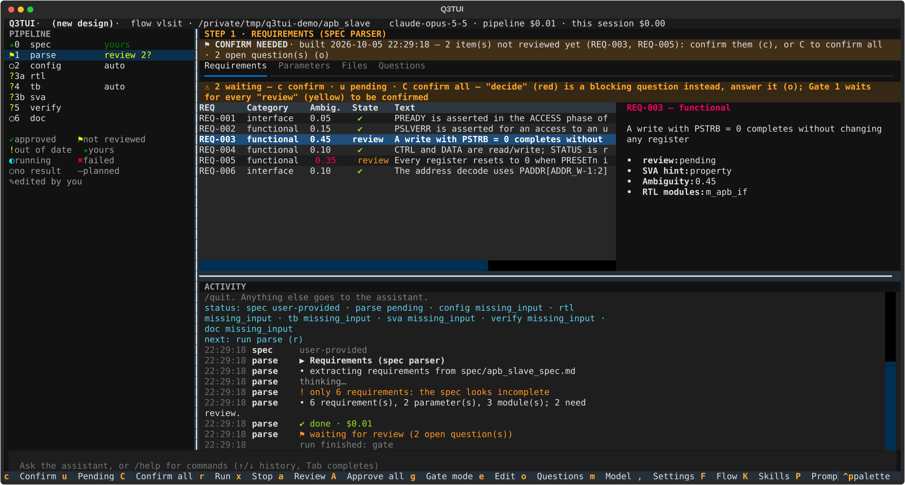
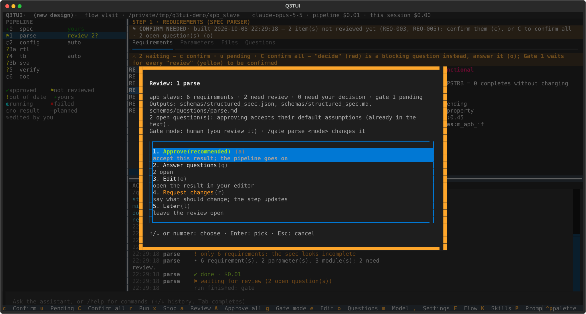

# Q3TUI User Guide (English)

Also available: [Tiếng Việt](vi.md).

Q3TUI runs the **spec flow**: `spec → parse → config`, and the **rtl flow** (`rules → csr → rtl → format → style_lint → smoke` after the same three steps). The testbench, SVA, verification and document steps were removed. This guide covers
installing it, running a project start to finish, the rule system RTL is checked against, every setting, and
every command/key you'll use day to day.

- [1. Install](#1-install)
- [2. Start a project](#2-start-a-project)
- [3. The flow, step by step](#3-the-flow-step-by-step)
- [4. Gates and review](#4-gates-and-review)
- [5. RTL coding rules](#5-rtl-coding-rules)
- [6. Settings](#6-settings)
- [7. Commands and keys](#7-commands-and-keys)
- [8. Input and output](#8-input-and-output)
- [9. The assistant (chat)](#9-the-assistant-chat)
- [10. The RTL flow](#10-the-rtl-flow)

## 1. Install

```bash
git clone <this repo> && cd Q3TUI
uv sync                                                          # Python >= 3.11
mkdir -p ~/.q3tui && cp q3tui.example.yaml ~/.q3tui/q3tui.yaml   # your defaults: model, EDA tool modules
```

LLM access uses the Claude Agent SDK's normal auth: an existing Claude Code login, `ANTHROPIC_API_KEY`, or a
gateway/Bedrock/Vertex via `llm.env` in `q3tui.yaml`. EDA tools (lint, synthesis, simulation) load through
environment modules (`tools.modules`, or a per-role override) — a role with no tool configured is reported
**N/A**, never silently skipped.

To install the `q3tui` command system-wide instead of running it from the repo: `./install.sh` (uses
`uv tool install`; `./install.sh --uninstall` removes it, your `~/.q3tui` settings and projects are untouched).

## 2. Start a project

A project is any directory with a `spec/` folder (or a `q3tui.yaml`). Q3TUI writes its deliverables under
that directory and keeps its own state in `.q3tui/` (never read by the LLM).

```bash
mkdir my_block && cd my_block
mkdir spec && vi spec/my_block_spec.md      # write your spec, or start from an intent (see below)
q3tui                                       # opens the TUI
```

**Starting point — a spec, or just an intent:**
- **A spec file** in `spec/` (Markdown, or a PDF) — `parse` reads it as-is.
- **An intent only** (`spec/intent.md`, a short paragraph of what you want built) — the `spec` step drafts a
  full spec from it section by section, asks what's left open, and only then hands off to `parse`.

### The screen



| Area | What it shows |
|---|---|
| **Pipeline** (left) | Every step: status icon (legend below it), number (`1`–`9` jump to it), gate mode or what it is waiting for (`review 2?`). |
| **Step view** (top right) | The selected step's result, in tabs (Requirements / Parameters / Files / Questions / …). A banner on top says what the step needs from you. |
| **Activity** (bottom right) | The live log of the run, and the assistant's replies. `z` zooms it. |
| **Command / chat bar** | `/command` (Tab completes, ↑/↓ history), or plain text to the assistant (`i` focuses it). |
| **Footer** | The keys of whatever has focus; `?` lists them all. |

Drag the dividers (or `ctrl+arrows`) to resize; sizes are kept per project.

## 3. The flow, step by step

```text
spec ─► parse ─► config
 human   Gate 1   Gate 2
         human    auto
```

| Step | What it does | Gate |
|---|---|---|
| **spec** | Drafts (or accepts your) IP specification. | human |
| **parse** | Extracts requirements (REQ-IDs), parameters, module map from the spec; flags ambiguity. | **1 · human** |
| **config** | Resolves parameter values against your change requests; checks elaboration constraints. | 2 · auto (self-signs when constraints pass) |

The RTL comes from the `rtl` flow (`pipeline.flow: rtl`, `q3tui --flow rtl run`), which reuses these three steps and adds the
rules, the CSR, the RTL, a Verible format and style lint, and a smoke test (docs/spec/rtl-flow.md).

**Updates, not re-runs:** editing a requirement, a parameter, or asking for a change re-runs only what that
change actually affects — earlier steps and your existing approvals are untouched unless the change reaches
them.

## 4. Gates and review

A gate is a stop for your decision. Every gate has a **mode**:

| Mode | Behavior |
|---|---|
| `human` | Always stops; only you can approve (`a` / `/approve`). |
| `auto` | Approves itself once there are no *blocking* questions — unconfirmed review items (below) don't count against it. |
| `auto_answer` | Unattended: approves itself, answers every question (blocking too) with its default. |
| `none` | No gate at all. |

Change a gate's mode: `g` (picker) or `/gate <step> <mode>`. `pipeline.auto_approve` / `pipeline.auto_answer`
(settings, or `/autoapprove` `/autoanswer`) override every gate's mode at once.

**Two things a gate can be waiting on**, shown right on the step's result banner:

- **A blocking question** — an actual decision only you can make (an ambiguous requirement, a parameter
  conflict, …). Open the Questions tab (`o`) and answer it.
- **Unconfirmed review items** — flagged requirements, or parameters changed from default
  that nobody has looked at yet. These never block an `auto`/`auto_answer` gate (it signs itself, and the
  items simply stay open), but they **do** block a plain `Approve` (`a`) on a `human` gate,
  unless you turn on `pipeline.auto_confirm_reviews`.



`a` opens the review dialog above: approve, answer the open questions, edit the result, request changes, or
leave it for later.

**Reviewing and confirming** (per step, in its own panel tab):

Uppercase key = **Shift+that letter**, a separate key from its lowercase version (e.g. `C` is not `c`).

| Step / tab | Key | Action |
|---|---|---|
| parse → Requirements | `c` | Confirm the highlighted flagged requirement as read |
| | `u` | Take it back to pending |
| | `C` (Shift+c) | Confirm every flagged requirement |
| config → Parameters | `c` / `u` / `C` (Shift+c) | Same, for parameters changed from default |


`/approve <step> --force` and `/approve all` bypass blocking questions *and* unconfirmed reviews the same
way `--force` always has — use it when you've judged it fine, not as a habit.

## 5. RTL coding rules

Every RTL stage reads a **rule file** (plain Markdown, the same text an engineer would read) and a
**deterministic checker** verifies what's objectively checkable against it — naming patterns, prohibited
constructs, name length, file/module-name match, and more. The LLM is told the rules; it does not get to
decide whether it followed them.

- **Default baseline:** `q3tui/flows/rtl/rtl/rules/rtl_rule_default.md` — ASIC synthesis
  rules (naming, DFT port conventions, prohibited constructs P1–P29, a tapeout-readiness checklist).
- **Add your own:** drop a rule file (e.g. `my_rules.md`) in your project root and list it alongside the
  default in `pipeline.step_options.rtl.rules` in `q3tui.yaml`:
  ```yaml
  pipeline:
    step_options:
      rtl:
        rules: [rtl_rule_default.md, my_rules.md]
  ```
  A project file with the *same name* as the shipped default overrides it outright (checked first).
- **What's enforced in code today:** naming prefixes (`i_`/`o_`/`reg_`/`w_`/module/instance/parameter
  patterns), name length (30 chars, default profile), prohibited testbench-only system tasks (`$display`,
  `$finish`, `$random`, …) — `$error` is allowed only as the sanctioned elaboration-time parameter-validation
  exception — `casex`, `defparam`, `inout` outside a pad wrapper, signed types/literals, two-state types,
  `` `define ``/`` `undef ``, and more. Anything not mechanically checkable (e.g. the abbreviation table,
  combinational-loop freedom) stays guidance the LLM follows from the rule text.

## 6. Settings

Open with `,` (Settings dialog) or `/settings [tab]`; every setting is also readable/settable by the
assistant (`get_settings` / `set_settings`). Add `--save` to a `/command` form, or leave "Only for this
session" unticked in the dialog, to persist a change to `q3tui.yaml`; leave it ticked (or omit `--save`) to
try something for this session only.

The dialog has one tab per area: **General**, **Gates**, **LLM**, **Models per step**, **Spec**, **RTL**.

### General

| Setting | Type | What it does |
|---|---|---|
| `pipeline.auto_approve` | bool | Every gate approves itself; a gate with blocking questions still stops and asks. |
| `pipeline.auto_answer` | bool | Unattended: every gate approves itself, every question (blocking too) takes its default, and proposals are accepted as suggested. |
| `pipeline.max_fix_iterations` | int | How many times a step's check → fixes → check loop may repeat before stopping and handing it to you. |
| `pipeline.escalate_after_repeats` | int | A bug classified the same way this many times in a row is handed to you instead of being fixed again automatically. |
| `pipeline.auto_confirm_reviews` | bool | Confirms a step's own reviewable items (flagged requirements, changed parameters) without asking. A human gate still stops for `Approve`; `Approve` itself no longer refuses for unconfirmed items. Narrower than auto-approve/auto-answer above — gates still stop, only per-item review is skipped. |
| `tui.icons` | choice | Status icon set: `unicode` (✔ ⚑ ◐ …), `nerd` (needs a "… Nerd Font Mono" font), `ascii` (any font). |
| `tui.language` | choice | TUI chrome (legend, result banners, dialogs) and pipeline-generated content (spec, RTL comments, questions, docs): `en` / `vi` / `ko`. The assistant chat is unaffected — it always mirrors whichever language you write to it in. |

### Gates

One mode selector per step with a review gate: **human** (stops for you) / **auto** (approves itself;
blocking questions still stop it) / **auto-answer** (unattended) / **none** (no gate at all). Same as
pressing `g` on a step, or `/gate <step> <mode>` — this tab just shows every step's mode together. See
[§4](#4-gates-and-review) for what each mode actually does.

### LLM

| Setting | Type | What it does |
|---|---|---|
| `llm.model` | choice | Default model for every stage from the next stage on: Opus 5.5 (best quality, default), Sonnet 5.5 (faster/cheaper), Haiku 4.5 (cheapest, no effort setting), Fable 5.1 (most capable, most expensive). |
| `llm.effort` | choice, nullable | How hard the model thinks: `low` / `medium` / `high` / `xhigh` / `max`. Empty for Haiku 4.5 (it has no effort setting). |
| `llm.thinking_budget` | int, nullable | Only for models without an effort setting (Haiku 4.5): caps thinking tokens. `0` = off, empty = model default. |
| `llm.max_budget_usd` | float, nullable | Stop a stage that costs more than this (empty = no limit). |
| `llm.tool_output_limit` | int | What one tool call may return; results are re-sent every later turn, so long ones are cut (head + tail kept). |
| `llm.stage_token_budget` | int, nullable | Warn when one stage reads more input tokens than this (cache included; empty = never warn). |
| `llm.timeout_s` | int, nullable | Wall-clock limit per LLM stage (empty = none, same as Claude Code). |
| `llm.fallback_model` | text, nullable | Used when the primary model is overloaded (empty = none). |

### Models per step

One `model` + `effort` pair per step (spec, parse, config, rtl) and for the assistant —
leave unset to use the LLM tab's default. Lets you mix models,
e.g. Opus where precision matters, Haiku for mechanical/high-volume work.

### Spec

| Setting | Type | What it does |
|---|---|---|
| `spec.self_review` | bool | A second pass that checks the draft for ambiguities and returns only its changes. Off = faster drafts, no ambiguity check. |

### RTL

| Setting | Type | What it does |
|---|---|---|
| `rtl.parallel` | int | Modules written at once. |
| `rtl.max_fix_attempts` | int | Extra rounds when lint or synthesis still fail. |
| `rtl.max_turns` | int | Agent turns for one module (write, compile, fix). |

The coding rules are the rtl flow's own rule files, see [§5](#5-rtl-coding-rules).

## 7. Commands and keys

Press `/` to type a command (Tab/→ completes); the same actions are keys when a step view has focus. A
single-letter key shown **uppercase** means **Shift+that letter** — it is a different key from its lowercase
version, and in this flow the two are never the same action.

| Action | Key | Command |
|---|---|---|
| Run the pipeline (optional range) | `r` | `/run [from] [to]` |
| Stop the running step / the assistant's reply | `x` | `/stop` |
| Open the review gate dialog | `a` | — |
| Approve a gate, or every gate waiting | `A` (Shift+a) | `/approve <step>|all [--force]` |
| Queue a change request for a step | — | `/change <step> <text>` |
| Answer a question | — | `/answer <id> <text>` / `/answer all` |
| Open Questions tab | `o` | — |
| Set a gate's mode | `g` | `/gate <step> <mode> [--session]` |
| List every gate | — | `/gates` |
| Flow editor | `F` (Shift+f) | `/flow` |
| Skill editor | `K` (Shift+k) | `/skill` |
| Prompt editor | `P` (Shift+p) | `/prompts` |
| Customise a step (view/pass/notes) | — | `/step <step> view|pass|notes [text]` |
| Reset a step's outputs (or everything) | `R` (Shift+r) | `/reset <step>|all [--only]` |
| Edit the current file | `e` | — |
| Comment on selected text / a highlighted row | `C`\* (Shift+c) | — |
| Switch model / reasoning effort | `m` | `/model [id]` / `/effort <level>` |
| Toggle self-review / auto-approve / auto-answer / auto-confirm | — | `/specreview` `/autoapprove` `/autoanswer` `/autoconfirm on|off` |
| Settings dialog | `,` (comma) | `/settings [tab]` |
| Usage statistics | `s` | `/stats [reset]` |
| LLM cost so far | — | `/cost [reset]` |
| Select step 1–9 | `1`–`9` | — |
| Resize panes | ctrl+arrows, or drag | — |
| Zoom the chat/activity pane | `z` | — |
| Focus the chat input | `i` | — |
| Start a fresh assistant conversation | — | `/newchat` |
| Quit | ctrl+q | `/quit` |
| Help | `?` (shift+/) | `/help` |

\* `C` (Shift+c) is **Comment** app-wide, but **Confirm all** when a Requirements/Parameters tab
has focus — see [§4](#4-gates-and-review). The step-specific review keys (`c`/`u`/`C` to confirm) are listed in that table, not repeated here.

## 8. Input and output

```text
spec/<ip>_spec.md                       your input (or the spec step's own output, from an intent)
schemas/structured_spec.json            parse    — Gate 1
schemas/final_config.json               config   — Gate 2
schemas/synth_report.json               rtl
reviews/{parse,config}_reviews.json     your per-item reviews (kept across a reset)
src/rtl/*.sv, filelist.f                    rtl (rtl flow)
config/{tools,pdks}.json, rtl_rules.md   your configuration
constraints/sdc/                        the SDC (fpga / asic / sanity flows)
reports/  build/                        readable results / disposable tool output
.q3tui/…                                internal only — never read by an LLM stage
```

## 9. The assistant (chat)

Type anything that isn't a `/command` into the bottom input and it goes to the assistant — it has a tool for
every action in this guide (run a step, answer a question, change a gate mode, review a requirement, change settings, …) and asks for confirmation before anything destructive (reset, turning on
unattended modes). It always replies in whatever language you write to it in, independent of `tui.language`.

## 10. The RTL flow

`pipeline.flow: rtl` (in `q3tui.yaml`, or `q3tui --flow rtl`) runs RTL generation on its own, checks it and smoke-tests it; verification is left to another flow.
Design reference: `docs/spec/rtl-flow.md`.

```
spec → parse → config → rules → csr → rtl → format → style_lint → smoke
```

1. **Your rules.** `q3tui act rtl_rules_init` writes `config/rtl_rules.md`: one rule per bullet, `- **ID** text`. They are read before Q3TUI's default rules (same id =
   override). The `rules` step checks them for contradictions (it stops with the exact text to change) and writes the Verible flags to `src/rtl/style_lint/`.
2. **Registers.** If the spec has a register map, the `csr` step drafts `src/rtl/csr/csr_map.json` and generates the register block with the APB-CSR-Generator
   (`q3tui act csr_tool_install` once; or set `csr.tool_dir` / `$CSR_GEN_HOME`). Edit `csr_map.json` to change a register: it is yours after the first draft. `csr.mode: off` skips it.
3. **RTL, format, style lint.** `rtl` follows the rules; `format` only changes whitespace (it asks before touching a file you edited); `style_lint` runs Verible and sends
   violations back to `rtl`. This repeats by itself, up to `style_lint.max_rounds`.
4. **Smoke test.** A small testbench written from the spec only, compiled and run (tool roles `sim` and `run`). A failure is triaged and fixed, or becomes a question for you.

Tools: Verible (`verible_lint`, `verible_format`) and the CSR generator come with the flow's defaults; `sim` / `run` / `lint` / `synth` come from your `config/tools.json` (the Synopsys
preset when you have none). A missing tool makes its step wait and name the role. **Skills:** the LLM stages read playbooks (`config/skills/<name>/SKILL.md`); put your own in
`<project>/config/skills/` to add or replace one. `q3tui act style_show` and `q3tui act csr_show` print what the flow decided.
